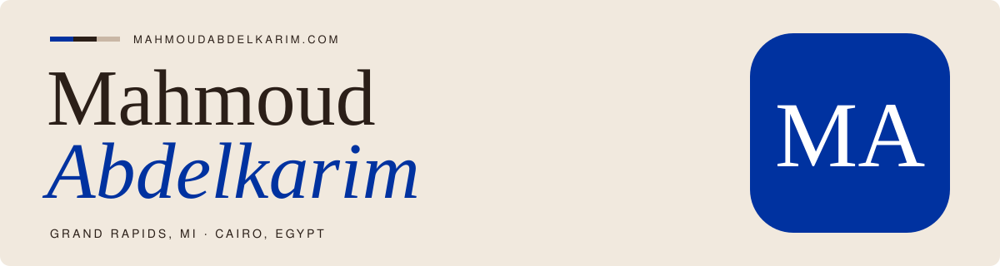
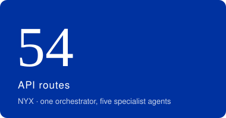
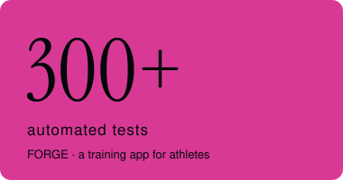
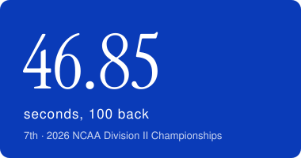
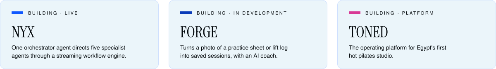

  

AI student at Grand Valley State. I build AI systems end to end: multi-agent apps, data pipelines, evals.

 

  

  

TypeScript &nbsp;·&nbsp; Python &nbsp;·&nbsp; SQL &nbsp;·&nbsp; Next.js &nbsp;·&nbsp; Supabase &nbsp;·&nbsp; Claude API &nbsp;·&nbsp; pgvector

Seeking Summer 2027 internships in technical program management, product and AI.

<a href="https://www.mahmoudabdelkarim.com">mahmoudabdelkarim.com</a>

